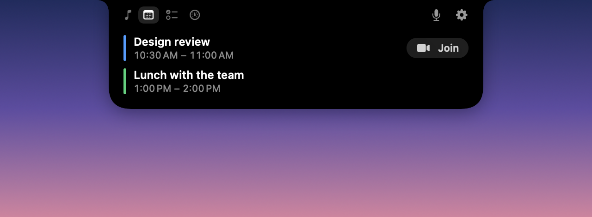
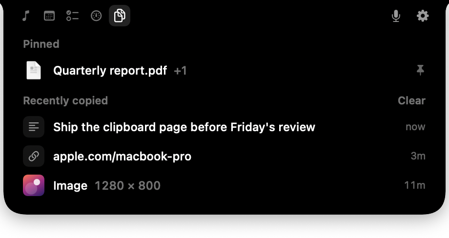

# Topsail

A Dynamic Island for the MacBook notch. Topsail turns the notch into a small black island that
shows what's playing, what's next and what your Mac is doing, and grows when you move the
pointer to it.

**[Website](https://sriramkansala.github.io/topsail/)** · **[Download](https://github.com/sriramkansala/topsail/releases/latest)** · **[Privacy policy](https://sriramkansala.github.io/topsail/privacy.html)**

<p align="center">
  
</p>

## What it does

**When you hover over the notch**, the island opens to one of five pages:

| | |
|---|---|
|  | **Calendar.** Your next events today and tomorrow, with a Join button for Zoom, Meet, Teams, Webex and FaceTime links. |
|  | **Tasks.** Your Linear issues for the current cycle, grouped by status. Press ⌥ Space to dictate a voice note; the on-device model turns it into issue changes you review before anything is sent. |
|  | **System.** Battery, charger and power draw, per-core CPU, memory, GPU, network and free disk space. Sampled only while the page is open. |
|  | **Clipboard.** The last 50 things you copied (text, links, images, files), newest first. Click one to copy it again; pin one to keep it for good. Recent copies stay in memory only; pinned ones are saved on your Mac. Items password managers mark as secret are skipped. Needs **Always Allow** under Privacy & Security › Paste from Other Apps. |

**When something happens**, the island shows it beside the notch for a few seconds:

| | |
|---|---|
|  | Now playing in Music or Spotify. |
|  | Plugging in: a band of gold light falls through the island. |
|  | Low battery at 20 % and 10 %. Click it to turn on Low Power Mode… |
|  | …and it turns gold. |
|  | Copying: the notch reaches a little lower and says "Copied to clipboard". Hover it to open the clipboard page. |
|  | Volume and brightness, in place of the macOS indicators. While Spotify plays on another device (a phone, a speaker, a TV), the volume keys turn that device up and down. |

**Switched off until you turn them on** (Settings › Features): a file shelf with AirDrop, Apple
Reminders, Keep Awake, a teleprompter and a pixel-art koi pond (a page you can feed the koi on, and
now and then a koi swimming under the notch); and, in the direct download, AI coding agents (Claude
Code, Codex, Cursor and Antigravity: progress, and Approve or Deny, in the notch), other apps'
notifications, an Apps page (Terminal, Chrome, YouTube) and automatic updates. English, French and
Spanish.

It also shows headphones and speakers connecting, in a card under the notch with each earbud's and
the case's battery (in the direct download) while the playing track stays beside the notch, and
Linear issues coming due. Before a call
with a video link, a countdown sits beside the notch; as it starts, a card asks **Join**,
**Ignore** or **Remind me in 5 min**. Each one can be turned off in Settings.

## Requirements

- macOS 26 or later.
- A MacBook with a notch is best. On other displays the island sits at the top centre of the
  menu bar.
- Voice notes need Apple Intelligence and a Linear account.

## Two builds

Topsail builds in two flavours from the same code:

| | App Store | Direct download |
|---|---|---|
| Bundle id | `app.topsail.Topsail` | `app.topsail.Topsail.direct` |
| Sandbox | Yes | No (hardened runtime, notarised) |
| Brightness keys | Left to macOS | Taken over, with Topsail's own indicator |
| Battery figures | From the IORegistry | Live power from the SMC as well |
| Low-battery click | Opens Battery settings | Turns on Low Power Mode through a small helper |
| Volume keys | Left to macOS until you turn on "Hide macOS volume indicator" | Taken over from the start |

The direct build is compiled with the `DIRECT` flag, and everything that uses private API or
needs root sits inside `#if DIRECT`, so none of it is in the App Store binary.

The Low Power Mode helper is a launchd daemon registered with `SMAppService`. macOS asks you to
allow it once, under System Settings › General › Login Items. It only accepts connections
from Topsail signed by the same team (and, in a release, only from Topsail signed with that team's
Developer ID), a release's daemon plist tells launchd to run only the helper that team signed,
and it can only do one thing: set Low Power Mode on battery (`pmset -b`). To remove it, turn it
off in Login Items.

## Building

You need Xcode 26.

```bash
scripts/build.sh
```

That builds the App Store flavour into `build/Topsail.app`. Add `--direct` for the direct
flavour (`build/Direct/Topsail.app`) and `--install` to replace `/Applications/Topsail.app` and
relaunch it. If you have an Apple Development certificate, dev builds are signed with it, so
permissions you grant survive rebuilds. Without one, they are signed ad hoc and macOS asks for
permissions again after each rebuild.

You can also open `Topsail.xcodeproj` in Xcode and run the `Topsail` scheme, which builds the
App Store flavour.

In debug builds, `open topsail://preview/low-battery` or `open topsail://preview/charging` shows
that activity without unplugging or draining the battery. `open topsail://settings` opens
Settings in any build.

## Releasing

Both need a paid Apple Developer Program membership.

- **Mac App Store:** `TEAM_ID=… scripts/release.sh` archives and exports a signed package to
  upload with Transporter. The listing text, privacy answers, review notes and 2880 × 1800
  screenshots are in [`appstore/`](appstore/metadata.md).
- **Website download:** `TEAM_ID=… NOTARY_PROFILE=… scripts/release-direct.sh` signs with
  Developer ID, notarises and staples `build/Direct-Release/Topsail.zip` (setup steps are at the top
  of the script). Publish it as a GitHub release, and the website's download buttons point at
  it:

  ```bash
  gh release create v1.0.0 build/Direct-Release/Topsail.zip --title "Topsail 1.0.0"
  ```

  Before publishing, check on a clean Mac that one-click Low Power Mode works with the notarised
  build.

The website is `website/`, plain HTML and CSS; `.github/workflows/website.yml` publishes it to
GitHub Pages whenever it changes on `main`.

## Permissions

Topsail asks for each permission the first time a feature needs it:

| Permission | Used for |
|---|---|
| Calendars | The calendar page and meeting reminders |
| Automation (Music, Spotify) | Reading and controlling what's playing |
| Input Monitoring and Accessibility | Handling the volume (and brightness) keys, so macOS's own indicator stays hidden |
| Microphone | Voice notes |

Everything runs on your Mac. Your Linear API key is kept in the keychain, and voice notes are
transcribed and understood on device. Topsail has no analytics. The only servers it talks to are
Linear's API, if you connect it, and Spotify's, for album art. See the
[privacy policy](https://sriramkansala.github.io/topsail/privacy.html).

## Project layout

```
Topsail.xcodeproj
Topsail/
  App/            app delegate, menu bar item
  Notch/          the island: window, geometry, shape, view model
  Activities/     live activities: charging, low battery, volume, audio devices
  Calendar/       EventKit and the calendar page
  Media/          Music and Spotify through AppleScript
  System/         battery, performance and brightness
  Tasks/          Linear client and the tasks page
  Voice/          voice notes: recording, transcription, planning, review
  Settings/       the Settings window
  Design/         motion, layout constants
  Pond/           the koi pond's views and art
  Resources/      Info.plist, entitlements, privacy manifest, app icon
Packages/PondKit/ the koi pond's renderer (always built optimised)
TopsailHelper/    the direct build's Low Power Mode daemon
scripts/          build, sign and release
website/          the website, also home to the README's images
appstore/         Mac App Store listing and screenshots
prototypes/       browser prototypes (the koi pond's pixel style, stage by stage)
```

`Design/Motion.swift` holds every animation in the app; its header explains the rules they
follow.

## Credits

The low-battery notice follows Raphael Salaja's recreation of the iOS 26 low-battery
notification ([write-up](https://www.raphaelsalaja.com/work/low-battery-notification)).

The koi pond is drawn from Blender renders of
["Koi Fish"](https://sketchfab.com/3d-models/koi-fish-3e1b80c3653f43349252aab3b4fb1d86) by SDPM
Esare (CC BY 4.0) and
["Water Lily"](https://sketchfab.com/3d-models/water-lily-6e47f3a59c204db3ae312eed9169aef8) by Xan
San (CC BY 4.0), with lily pads from
["CC0 Water Lily, Nymphaea cv."](https://sketchfab.com/3d-models/cc0-water-lily-nymphaea-cv-e7830f486a0248b6b894f3e7a63b8c16)
by ffish.asia / floraZia.com (CC0); the changes made to them are listed in
`Topsail/Pond/Art/CREDITS.txt`.

## License

[MIT](LICENSE)
